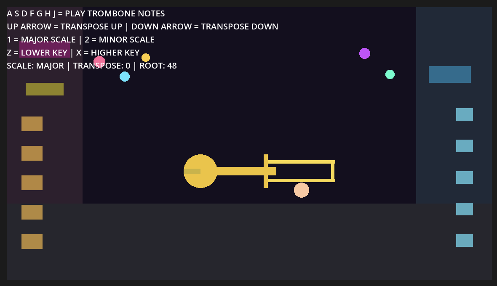

# Trombone Tunes

Name: Charlie Casey Carney

Student Number: A00023955

Class Group: Group A / TU850

# Video on YouTube

# Screenshots

This is an image using a relative URL:

This is an image using an absolute URL:

This is a youtube video for my project:

[![YouTube][def]](https://youtu.be/sRfauO2071Y)

# Description of the project

This Project includes an interactive trombone that allows you to play in major and
minor scales, go up and down in semi-tones, and go up and down different keys. I got
inspiration from playing trombone myself when I was younger. 

# Instructions for use

A S D F G H J = play trombone notes
UP arrow = transpose up
DOWN arrow = transpose down
1 = major scale
2 = minor scale
Z = lower key
X = higher key

# How it works:

The player uses the keyboard to play notes, and the _input() function detects which
keys are pressed. The project uses send_note_on() and send_note_off() to send MIDI
messages to the trombone instrument. The get_scale_note() function helps switch
between major and minor scales, while variables like transpose and root_note let the
pitch and key, change while playing. The trombone slide is animated using lerp() in
_process(), and _draw() is used to create the colourful jazzy laneway, floating music
notes, and trombone visuals. A timer also runs a repeating bass pattern in the
background to make the scene feel more musical.

# List of classes/assets in the project

| Class/asset | Source |
|-----------|-----------|
| Main.gd | Self written |
| MidiPlayer.gd| From [arlez80] / Modified from class examples [Bryan's-Repo](https://github.com/skooter500/cc26.git) |
| trombone_image.png | Self Made |
| background-image.png | Self Made |
| List_of_sounds | From [SoundProgramming](https://soundprogramming.net/file-formats/general-midi-instrument-list/) |
| Godot_Project_for_creative_coding.godot | Generated by Godot |

# References
* Bryan Duggan's Github Repo From [Bryan Duggan](https://github.com/skooter500/cc26.git)
* List of different instruments From [SoundProgramming] (https://soundprogramming.net/file-formats/general-midi-instrument-list/)
* Youtube Tutorials from [Larsi uncut](https://www.youtube.com/watch?v=nuf5GFMgazM&t=76s)
* Godot engine 4 from [Godot](https://godotengine.org/)
* Git Manual from [Git](https://git-scm.com/docs/user-manual.html)
* Vscode for README [Visual Studio Code](https://code.visualstudio.com/)
* Imgur for absolute URL [imgur](https://imgur.com/a/q8EHOlP)
* Reddit Godot tips and tricks [Reddit]()

# What I am most proud of in the assignment

- What I am most proud of in this assignment is how I linked the sound with the
animation. When the player presses a key, the program does not just play a trombone
note, it also moves the trombone slide to match that note. I did this by giving each
keyboard key its own note and slide position, then using the input function to detect
the key press. The sound is played through the MIDI player, while the slide animation
moves smoothly using lerp() in the process function. I also added floating music notes
that appear when a note is played, which makes the interaction feel more alive and
attractive to the user. This made the project feel less like just pressing buttons and
more like actually controlling a musical instrument on screen. As well as that,
figuring out how to allow for scale changes, key changes and semi-tone changes using
keyboard input and making the notes flexible was very useful and made the project even
more interactive for the user. 

# What I learned

- The main thing I learned from this project was how to connect sound, interaction,
and animation together in Godot. I learned how keyboard input can control MIDI notes,
how variables like transpose and root_note can change pitch and key, and how scale
arrays can switch the music between major and minor. I also learned how to make the
visuals react to the sound, such as moving the trombone slide and showing floating
notes when a key is pressed. Overall, it helped me understand how coding can be used
creatively to make something that feels interactive, musical, and visual at the same
time.